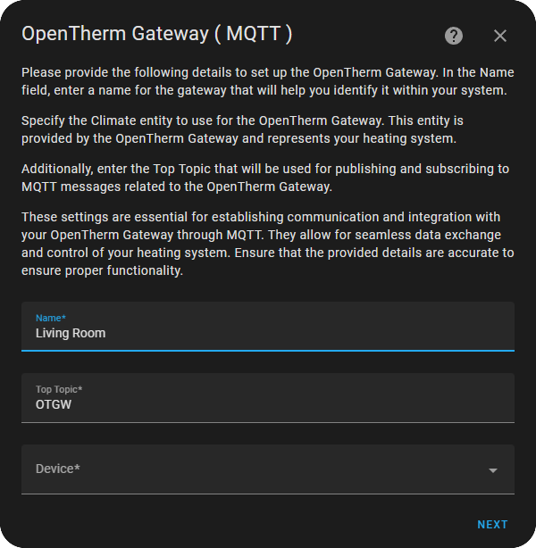
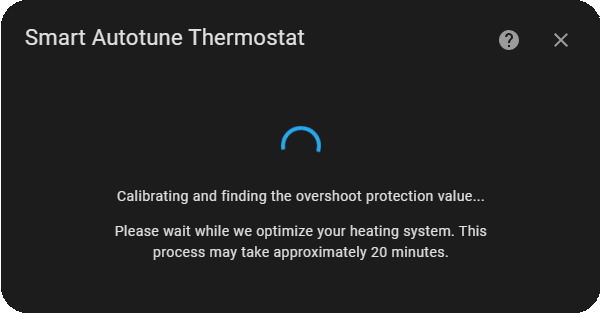

# Smart Autotune Thermostat

[![hacs][hacs-badge]][hacs-url]
[![release][release-badge]][release-url]
![build][build-badge]
[![discord][discord-badge]][discord-url]

**Please :star: this repo if you find it useful.**





## What is the Smart Autotune Thermostat?

The Smart Autotune Thermostat, or SAT for short, is a custom component for Home Assistant that seamlessly integrates with the following devices:
- [OpenTherm Gateway (OTGW)](https://otgw.tclcode.com/) (MQTT or Serial)
- [DIYLess](https://diyless.com/) Master OpenTherm Shield
- [Ihor Melnyk's](http://ihormelnyk.com/opentherm_adapter) OpenTherm adapter
- [Jiří Praus'](https://www.tindie.com/products/jiripraus/opentherm-gateway-arduino-shield/) OpenTherm Gateway Arduino Shield
- [EMS-ESP](https://emsesp.github.io/docs/) (MQTT, for Bosch, Junkers, Buderus systems)
- [OTThing](https://otthing.com/) (MQTT)

It can also function as a PID ON/OFF thermostat, providing advanced temperature control based on Outside Temperature compensation and the Proportional-Integral-Derivative (PID) algorithm. Unlike other thermostat components, SAT supports automatic gain tuning and heating curve coefficients. This capability allows it to determine the optimal setpoint for your boiler without any manual intervention.

---

## Features
OpenTherm ( MQTT / Serial / ESPHome / EMS-ESP / OTThing ):
- Multi-room temperature control with support for temperature synchronization for main climates
- Adjustable heating curve coefficients to fine-tune your heating system
- Heating curve recommendation with a suggested coefficient, learned from a week of steady heating after sunset, only while the room the boiler heats for holds its target, and weighed per day so one stormy day cannot skew it. Each day also shows its median wind speed, so you can see how wind changes the heat your house needs. Over months of mixed weather it learns a calm-weather coefficient and how much more heat every 10 km/h of wind costs
- Target temperature step for adjusting the temperature in smaller increments
- Presets for different modes such as Away, Sleep, Home, Comfort
- Automatic gains for PID control
- PWM and Automatic-duty cycle
- Overshoot protection to prevent the boiler from overshooting the setpoint ( Low-Load Control )
- Climate valve offset to adjust the temperature reading for your climate valve
- Sample time for PID control to fine-tune your system's response time
- Open Window detection
- Frost protection that keeps heating when a room gets too cold, even while turned off
- Domestic hot water control through a water heater entity (setpoint and on/off)
- Boiler fault reporting with Home Assistant repair issues
- Gas consumption sensors, including a total for the Energy dashboard
- Solar gain compensation to adjust heating based on passive solar heating
- Boiler pressure monitoring
- Adaptive preheat, presence, and holiday automation blueprints
- Long-term insights: boiler trends, room balance, a seasonal heating curve fit and heating efficiency (see [Insights](#insights))
- Config entry diagnostics for easy issue reporting

PID ON/OFF thermostat:

- Multi-room temperature control with support for temperature synchronization for main climates
- Adjustable heating curve coefficients to fine-tune your heating system
- Target temperature step for adjusting the temperature in smaller increments
- Presets for different modes such as Away, Sleep, Home, Comfort
- Automatic gains for PID control
- PWM and Automatic-duty cycle
- Climate valve offset to adjust the temperature reading for your climate valve
- Sample time for PID control to fine-tune your system's response time
- Open Window detection
- Frost protection that keeps heating when a room gets too cold, even while turned off
- Solar gain compensation to adjust heating based on passive solar heating

---

## Installation
### HACS

Smart Autotune Thermostat ( SAT ) is available in [HACS][hacs] (Home Assistant Community Store).

Use this link to directly go to the repository in HACS

[](https://my.home-assistant.io/redirect/hacs_repository/?owner=Alexwijn&repository=SAT)

_or_

1. Install HACS if you don't have it already
2. Open HACS in Home Assistant
3. Search for "Smart Autotune Thermostat"
4. Click the download button. ⬇️

### Manual
1. Download the latest release of the SAT custom component from the GitHub repository.
2. Copy the sat directory to the custom_components directory in your Home Assistant configuration directory. If the custom_components directory doesn't exist, create it.
3. Restart Home Assistant to load the SAT custom component.
4. After installing the SAT custom component, you can configure it via the Home Assistant Config Flow interface.

---

# Configuration
SAT is configured using a config flow. After installation, go to the Integrations page in Home Assistant, click on the Add Integration button, and search for SAT if the autodiscovery feature fails.

## OpenTherm

1. OpenTherm Connection
   - OpenTherm Gateway MQTT:
        - Name of the thermostat
        - Top Topic ( *MQTT Top Topic* found in OTGW-firmware Settings )
        - Device

   - EMS-ESP MQTT (for Bosch, Junkers, Buderus systems):
        - Name of the thermostat
        - Top Topic ( e.g. `ems-esp/` )

   - OTThing MQTT:
        - Name of the thermostat
        - Top Topic ( e.g. `otthing/31F44C` )

   - OpenTherm Gateway Serial:
        - Name of the thermostat
        - URL

   - ESPHome Opentherm:
        - Name of the thermostat
        - Device

> [!Important]
> SAT communicates with the ESPHome device directly via the native API. It discovers entities by their `object_id`, which ESPHome derives from the entity's `id` (or `name` when no explicit `id` is set). The ESPHome yaml must produce the exact `object_id` values shown below, otherwise SAT will not be able to discover them.
<details>
<summary>ESPHome minimal yaml configuration</summary>

```yaml
# Insert usual esphome configuration (board, api, ota, etc.)

opentherm:
  in_pin: # insert in pin
  out_pin: # insert out pin
  ch_enable: true
  dhw_enable: true

number:
  - platform: opentherm
    t_dhw_set:
      name: t_dhw_set
      step: 1
      restore_value: true
      initial_value: 45
    t_set:
      name: t_set
      restore_value: true
      initial_value: 10
    max_t_set:
      name: max_t_set
      step: 1
      restore_value: true
    max_rel_mod_level:
      name: max_rel_mod_level
      min_value: 0
      max_value: 100
      step: 1
      initial_value: 100
      restore_value: true

sensor:
  - platform: opentherm
    rel_mod_level:
      name: rel_mod_level
    device_id:
      name: device_id
    t_boiler:
      name: t_boiler
    t_ret:
      name: t_ret
    max_capacity:
      name: max_capacity
    min_mod_level:
      name: min_mod_level
    t_dhw_set_lb:
      name: t_dhw_set_lb
    t_dhw_set_ub:
      name: t_dhw_set_ub
    ch_pressure:
      name: ch_pressure

binary_sensor:
  - platform: opentherm
    flame_on:
      name: flame_on
    dhw_active:
      name: dhw_active
    ch_active:
      name: ch_active

switch:
  - platform: opentherm
    dhw_enable:
      name: dhw_enable
    ch_enable:
      name: ch_enable
```

For more information about which other entities are available for OpenTherm please visit the [ESPHome OpenTherm documentation](https://esphome.io/components/opentherm.html)

</details>

2. Configure sensors:
    - Inside Temperature sensor ( Your Room Temperature sensor; optional, see Rooms only under Areas )
    - Outside Temperature sensor ( Your Outside Temperature sensor )
    - Inside Humidity Sensor ( Your Room Humidity sensor )
    - Wind Sensor ( Optional wind speed sensor or weather entity; when empty, the wind speed of a weather entity among the outside sensors is used )

> [!NOTE]
> For better results use an Inside Temperature sensor that reports two decimals and has a refresh rate of 30 seconds.

3. Heating System: Selecting the correct heating system type is important for SAT to accurately control the temperature and optimize performance. The available options are Radiators, Heat Pump, and Underfloor. Choose the option that matches your setup to ensure proper temperature regulation throughout your home.

4. Areas:  
   - Primary: Users can add their physical thermostat. SAT will syncronize the `hvac_action` of the physical thermostat with the SAT climate entity's `hvac action`, that means if the physical thermostat doesn't require heating then the SAT climate entity `hvac_action` will remain at idle. Also the physical thermostat's room setpoint stays in sync with SAT climate entity. Moreover the physical thermostat will act as a back up if any failure to HA occurs.
   - Rooms: Users can add their TRV climate entities. So when any of the rooms will ask for heating, SAT will start the boiler.
   - Rooms only: If every heated room already has its own climate entity and there is no main room, leave the Inside Temperature sensor empty and add all rooms here. Each room then gets its own PID and heating curve, the boiler is asked for the highest room request, and it is only started while at least one room is calling for heat. The SAT climate entity stays as the on/off switch and the preset selector of the whole system: it has no target temperature of its own, shows the median room temperature, applies presets to the rooms (see the Room Presets tab), and while off it protects the coldest room against frost. Without a main room there is no Eco heating mode and no main PID, error or heating curve sensors; the room sensors and the boiler sensors are still created.
> [!Note]
> If SAT is the only climate entity, skip this step.

> [!TIP]
> Look at the Heating Mode setting in General Tab for further customization.

5. Calibrate System: Optimize your heating system by automatically determining the optimal PID values for your setup. When selecting Automatic Gains, please note that the system will go through a calibration process that may take approximately 20 minutes to complete.

> [!NOTE]
> If system calibration fails or you prefer to manually find the Overshoot Protection Value, please look at this [discussion](https://github.com/Alexwijn/SAT/discussions/36).

If you already know this value, then use the "Manually enter the overshoot protection value" option and fill the value.

Automatic Gains are recommended for most users as it simplifies the setup process and ensures optimal performance. However, if you're familiar with PID control and prefer to manually set the values, you can choose to skip Automatic Gains.

Please note that choosing to skip Automatic Gains requires a good understanding of PID control and may require additional manual adjustments to achieve optimal performance.

## PID ON/OFF

The PID ON/OFF mode allows SAT to control any switch, valve, or input_boolean entity as a simple on/off heater. This is useful for systems that don't support OpenTherm modulation.

1. PID ON/OFF Connection
   - Name of the thermostat
   - Device ( a switch, valve, or input_boolean entity that controls your heater )
   - Minimum Setpoint ( the operating temperature of your heater )

2. Configure sensors:
    - Inside Temperature sensor ( Your Room Temperature sensor; optional, see Rooms only under Areas )
    - Outside Temperature sensor ( Your Outside Temperature sensor )
    - Inside Humidity Sensor ( Your Room Humidity sensor )
    - Wind Sensor ( Optional wind speed sensor or weather entity; when empty, the wind speed of a weather entity among the outside sensors is used )

3. Heating System: Select Radiators, Heat Pump, or Underfloor.

4. Areas: Same as OpenTherm configuration above.

5. Calibrate System: Same as OpenTherm configuration above.

---

# Configure

## General tab:

*Heating Mode*:

> [!NOTE]
> Available only for multiroom installations with a main room

- Comfort ( SAT monitors the climates in other rooms to determine the error. It selects the highest error value as the PID error value for the current room )
- Eco ( SAT monitors **only** the Main thermostat's error and it is used as the PID error )

*Maximum Setpoint*:
You can choose the max water setpoint for your system.
For radiator installations, it is recommended to choose a value between 55-75 °C.
For underfloor installations, the recommended max water setpoint is 50 °C.

> [!NOTE]
>  Radiators: Higher Max water setpoint values will cause a more aggressive warm-up.

*Heating Curve Coefficient*:
The heating curve coefficient is a configurable parameter in SAT that allows you to adjust the relationship between the outdoor temperature and the heating system output. This is useful for optimizing the heating system's performance in different weather conditions, as it allows you to adjust how much heat the system delivers as the outdoor temperature changes. By tweaking this parameter, you can achieve a more efficient and comfortable heating system.

Heating curve reference graphs:

Radiators:
- [Classic Curve](https://www.desmos.com/calculator/cy8gjiciny)
- [Quantum Curve](https://www.desmos.com/calculator/hmrlrapnxz)
- [Precision Curve](https://www.desmos.com/calculator/spfvsid4ds) ( Recommended )

Underfloor:
- [Classic Curve](https://www.desmos.com/calculator/exjth5qsoe)
- [Quantum Curve](https://www.desmos.com/calculator/ke69ywalcz)
- [Precision Curve](https://www.desmos.com/calculator/i7f7uuyaoz) ( Recommended )

> [!NOTE]
> Graph parameters:
> - a: Heating Curve Value
> - b: Room Setpoint

> [!TIP]
> You can add the graph as an `iframe` card in HA.
>
> Example:
> ```yaml
> type: iframe
> url: https://www.desmos.com/calculator/spfvsid4ds
> allow_open_top_navigation: true
> allow: fullscreen
> aspect_ratio: 130%
> ```

*Proportional (kP) / Integral (kI) / Derivative (kD)*: When automatic gains are disabled, you can manually set the PID gains in this tab.

*Contact Sensors*: You can add contact sensors (window/door/garage door) to avoid wasting energy when a door/window is open. When the door/window is closed again, SAT restores heating.

## Presets tab:
Predefined temperature settings for different scenarios or activities: Home, Comfort, Sleep, Away, and Activity. These are the house-wide values: the main thermostat follows them directly, and the rooms follow them relative to their own home temperature.

*Synchronize with thermostat attached to the boiler*: Send SAT's target temperature to the boiler thermostat.

*Synchronize climates with preset*: When a preset is selected, also set the rooms. In rooms-only mode this is always the case.

## Room Presets tab:
Pick a room, tick the presets it has its own temperature for and set them. The Home temperature is the room's normal target; presets that are not ticked follow it with one rule: a preset only ever lowers the room, relative to its home temperature and never below the house-wide preset, and never raises it. So with Home 21, Sleep 19 and Comfort 23 a bedroom with a home temperature of 18 stays at 18 during Sleep and Comfort and goes to 16 when Away, while a kitchen at 21 goes to 19 and 16. Give the living room its own Comfort value to let it rise, or tick *Leave this room alone* for a room presets must never touch. A room without a Home temperature is never touched by presets. On the first start after this version SAT fills in the home temperatures it had remembered for your rooms.

## System Configuration tab:

*Duty Cycles per hour*: The maximum amount of duty cycles per hour. The available options depend on the heating system type (Radiators: 3-4x, Heat Pump: 2-3x).

*Synchronize climates with mode*: Also set HVAC mode on room climates when it changes on the main SAT climate entity.

*Temperature Sensor maximum value age*: The maximum age of the temperature sensor value before considering it as stale.

*Minimum time for window to be open*: The minimum time a window must be open before the system reacts and pauses heating.

*Frost Protection Temperature*: Keep heating when the room drops below this temperature, even while the thermostat is off. Set to 0 to disable.

## Advanced Tab

> [!NOTE]
> This tab is only visible when Home Assistant's advanced mode is enabled in your user profile.

*Simulation*: Enable simulation mode for testing.

*Error Monitoring*: Enable error monitoring via Sentry for diagnostics.

*Thermal Comfort*: Uses the Summer Simmer Index as the temperature sensor. The Summer Simmer Index refers to the perceived temperature based on the measured air temperature and relative humidity.

*Solar Gain Compensation*: When enabled, SAT adjusts heating output based on solar elevation to account for passive solar heating of the home. Related settings:
- *Solar Gain Minimum Elevation*: The minimum sun elevation angle before solar compensation activates.
- *Solar Gain Minimum Rise per Hour*: The minimum temperature rise rate to trigger solar gain detection.
- *Solar Gain Setpoint Offset*: The offset applied to the setpoint when solar gain is detected.
- *Solar Gain Freeze Integral*: Freeze the PID integral term during solar gain events to prevent windup.

*Force Pulse Width Modulation*: Force PWM mode on (only available for OpenTherm MQTT/Serial).

*Target Temperature Step*: SAT climate entity room setpoint step.

*Climate Valve Offset*: Adjust the temperature reading for your climate valve.

*Maximum Relative Modulation*: The user is able to control the maximum relative modulation that the boiler will operate (only available for OpenTherm MQTT/Serial).

*Minimum Consumption*: The user can find this value at the boiler's manual. SAT uses this value in order to calculate the instant gas consumption (only available for OpenTherm MQTT/Serial).

*Maximum Consumption*: The user can find this value at the boiler's manual. SAT uses this value in order to calculate the instant gas consumption (only available for OpenTherm MQTT/Serial).

---

# Insights

SAT learns from your home over days and seasons and reports what it finds. These are advice only: none of them change how your heating is controlled. The thresholds behind them are starting estimates, so treat a warning as something to check rather than a diagnosis.

## Heating Efficiency

The gas your home needs for heating per degree day, over the last 365 days. Lower is better. A degree day is one degree of outside temperature below 18 °C for one day, which corrects for the weather, and the gas used on warm days (hot water, cooking) is subtracted first.

SAT uses the gas meter from your Energy dashboard and the statistics of your outside temperature sensor, so with existing history it reports within a minute of starting. Without a meter it falls back to SAT's own gas estimate, which is less reliable; the `source` attribute shows which one is used.

The most useful comparison is your home against itself: `change_percentage` compares the last 365 days with the 365 days before them. As a rough guide for a home of about 100 m², scaled to your floor area:

| m³/°Cd | kWh/°Cd | Roughly means |
|---|---|---|
| Under 0.15 | Under 1.5 | Very well insulated |
| 0.15 to 0.30 | 1.5 to 3 | Good |
| 0.30 to 0.45 | 3 to 4.5 | Average older home |
| Over 0.45 | Over 4.5 | Poorly insulated |

These bands are approximate estimates, not a certified rating. A warmer setpoint, another heat source, more time at home or a sunny winter all move the number, so a change shows that demand shifted, not why.

## Room Balance

One sensor per room, plus one for the main climate, comparing how each room is supplied with heat. It needs at least 5 days of steady heating and another room to compare with.

- *Balanced*: nothing stands out.
- *Undersupplied*: the room needs more heat than the rest of the house, raising the flow temperature by about `flow_premium` °C. Check the radiator size, the lockshield balance, and drafts or open doors. Raises a repair issue.
- *Oversupplied*: the room warms quickly while another room is short. Closing its lockshield a little sends more water to the short room.
- *Sensor mismatch*: the room stays cold but its thermostat rarely asks for heat, so it probably reads warmer than the room. Raises a repair issue.
- *Device fault*: the thermostat reports a valve alarm. Raises a repair issue.

## Boiler Trends

Keeps a daily history of the boiler and raises a repair issue for slow pressure loss, frequent top-ups, or short cycling that is getting worse compared with days of similar weather. It takes at least two to three weeks of data before it can warn.

## Seasonal Curve Coefficient

Where the heating curve recommendation looks at the last week, this looks at up to 180 days of steady heating. Its attributes show the coefficient per outside temperature band, and `curve_mismatch` turns on when no single coefficient suits both cold and mild weather.

---

# Blueprints

SAT ships three automation blueprints in [`blueprints/automation/sat/`](blueprints/automation/sat) that you can import into Home Assistant:

- *Adaptive Preheat*: starts heating early so the room is at temperature by a chosen time or the start of the next calendar event. The lead time comes from the `sat.estimate_preheat` service, which learns how fast each room recovers at different outside temperatures. It uses the forecast when a weather entity with hourly forecasts is one of your outside sensors, and otherwise the current outside temperature.
- *Presence Presets*: switches between the home and away presets based on a person, group, or device tracker.
- *Holiday Mode*: follows a calendar; for the duration of an event it switches to the away preset and turns domestic hot water off, restoring both afterwards.

Import them via Settings → Automations & scenes → Blueprints → Import blueprint, using the raw GitHub URL of the blueprint file.

---

# Terminology
*Heating Curve Coefficient*: By adjusting the heating curve coefficient, you can balance the heating loss of your home with the energy generated from your boiler at a given setpoint based on the outside temperature. When this value is properly tuned, the room temperature should hover around the setpoint.

*Gains*: SAT offers two ways of tuning the PID gains - manual and automatic.

- Manual tuning: You can fill the Proportional, Integral, and Derivative fields in the General tab with your values.
- Automatic Gains ( Recommended ): This option is enabled by default when the Overshoot protection value is present (During initial configuration). Automatic gains dynamically change the kP, kI, and kD values based on the heating curve value. So, based on the outside temperature, the gains change from mild to aggressive without intervention.

*Overshoot Protection*: This feature should be enabled when the minimum boiler capacity is greater than the control setpoint calculated by SAT. If the boiler overshoots the control setpoint, it may cycle, shortening the life of the burner. The solution is to adjust the boiler's on/off times to maintain the temperature at the setpoint while minimizing cycling.

*Overshoot Protection Value (OPV) Calculation*:
The OPV is a crucial value that determines the boiler's on/off times when the Overshoot Protection feature is present (During initial configuration).

*Automatic Calculation*: To calculate the OPV automatically, choose the "Calibrate and determine your overshoot protection value (approx. 20 min)" option during the initial configuration. SAT will then send the MM=0 and CS=75 commands, attempting to find the highest flow water temperature the boiler can produce while running at 0% modulation. This process takes at least 20 minutes. Once the OPV calculation is complete, SAT will resume normal operation and send a completion notification. The calculated value will be stored as an attribute in the SAT climate entity and used to determine the boiler's on/off times in the low-load control algorithm. If SAT detects that the boiler doesn't respect the 0% Max Modulation command, it will automatically change the calibration algorithm to a more sophisticated one to perform the calibration of the system.

*Manual Calculation*: If you know the maximum flow water temperature of the boiler at 0% modulation, you can fill in this value during the initial configuration.

> [!Note]
> If you have any TRVs, open all of them (set them to a high setpoint) to ensure accurate calculation of the OPV. Once the calculation is complete, you can lower the setpoint back to your desired temperature.

*Automatic Duty Cycle*: When this option is enabled, SAT calculates the ON and OFF times of the boiler in 15-minute intervals, given that the kW needed to heat the home is less than the minimum boiler capacity. Moreover, using this feature, SAT can efficiently regulate the room temperature even in mild weather by automatically extending the duty cycle up to 30 minutes.

> [!TIP]
> For more in depth review of SAT and real time observations you can read this [excellent discussion post](https://github.com/Alexwijn/SAT/discussions/40) from @critictidier.

## Stargazers over time
[](https://starchart.cc/Alexwijn/SAT)

<!-- Badges -->

[hacs-url]: https://github.com/hacs/integration
[hacs-badge]: https://img.shields.io/badge/hacs-default-orange.svg?style=for-the-badge
[release-badge]: https://img.shields.io/github/v/tag/Alexwijn/SAT?style=for-the-badge
[downloads-badge]: https://img.shields.io/github/downloads/Alexwijn/SAT/total?style=for-the-badge
[build-badge]: https://img.shields.io/github/actions/workflow/status/Alexwijn/SAT/pytest.yml?branch=develop&style=for-the-badge
[discord-badge]: https://img.shields.io/discord/1184879273991995515?label=Discord&logo=discord&logoColor=white&style=for-the-badge

<!-- References -->

[hacs]: https://hacs.xyz
[home-assistant]: https://www.home-assistant.io/
[release-url]: https://github.com/Alexwijn/SAT/releases
[discord-url]: https://discord.gg/jnVXpzqGEq
